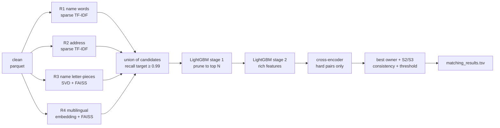

# Approach — research, comparison, combined plan

_2026-09-26. For team review before any more building._

**Lead:** the strongest known recipe for this kind of problem is **several fast retrievers combined → LightGBM on rich similarity features → a transformer re-scoring the hard pairs → structure-aware post-processing**. It's the recipe the 1st and 7th place teams used in Kaggle's *Foursquare Location Matching* (1,079 teams). We adapt it to our data (no coordinates, Indian scripts, unseen France, one owner per record).

## 1. What the research says

| Source | What they did | Numbers | What we take |
| --- | --- | --- | --- |
| **Foursquare Location Matching, 1st place** ([writeup](https://www.kaggle.com/competitions/foursquare-location-matching/writeups/re-waiwai-1st-place-solution)) | Candidates from text similarity + proximity → **light LightGBM to prune** → **top 40 per record into a rich LightGBM** (Levenshtein, Jaro-Winkler, SVD name embeddings) → **2 transformer models** on pairs → **GNN** post-processing | 1st of 1,079 | The 4-stage structure; pruning before rich features; transformers only on survivors |
| **Foursquare, 7th place** ([blog](https://future-architect.github.io/articles/20220720a/)) | **5 retrievers** (word BoW, char BoW, name embedding, …), 32 candidates per record → LightGBM with 100+ features (Gestalt, Levenshtein, Jaro-Winkler, ROUGE) → **union-find graph** post-processing | Retrieval upper bound **0.978**, **0.9935** after post-processing | Combining many cheap retrievers beats one perfect one; graph post-processing adds recall |
| **Foursquare, 21st place** ([writeup](https://www.kaggle.com/competitions/foursquare-location-matching/writeups/bulian-ai-21st-place-solution)) | Char 3-gram TF-IDF, then **SBERT embeddings + kNN** for blocking | Upper bound > 0.99 with combined embeddings | Dense embeddings fix what TF-IDF misses |
| **Sparkly** ([VLDB 2023](https://www.vldb.org/pvldb/vol16/p1507-paulsen.pdf)) | Top-k **TF-IDF/BM25** blocking | Beats 8 state-of-the-art blockers; tens of millions of rows | TF-IDF top-k is a strong base. **Weak on transliterations**, so it needs a second retriever |
| **Ditto / cross-encoders** ([VLDB J.](https://dl.acm.org/doi/10.1007/s00778-023-00779-z)) | Fine-tune a pre-trained transformer on (record A, record B) as a sequence pair | Up to +29% F1 over earlier state of the art | The best single *judge* for hard pairs; costly, so apply only to survivors |
| **LaBSE / multilingual E5** ([Google](https://research.google/blog/language-agnostic-bert-sentence-embedding/)) | Language- and script-independent sentence embeddings, 109 languages incl. Hindi and Kannada | — | Matches "ಲೋಟಸ್ ಮಾರ್ಕೆಟಿಂಗ್" to "Lotus Marketing" directly, beyond our rough transliteration |
| **Transitive-closure warning** ([ER in practice](https://arxiv.org/html/2607.26298)) | One false link can chain unrelated clusters | — | Our structure is a **star** (one owner per record), so we don't need full transitivity. Use "best owner" assignment, not union-find |

## 2. Approaches compared, for our data

| Stage | Option | Accuracy | Speed at our scale (10M records × 1.7M S1) | Verdict |
| --- | --- | --- | --- | --- |
| Retrieve | Exact keys (our 0.56 baseline) | Recall 0.49 | Instant | Too weak alone; keep as a cheap extra retriever |
| Retrieve | Sparse TF-IDF, name **words** | Recall 0.82 (sample) | **Fast**: 35 s for all India dev queries | **Keep** |
| Retrieve | Sparse TF-IDF, **address** words + numbers | Recall 0.94 (sample) | Unmeasured at full size; common tokens pruned | **Keep**, measure |
| Retrieve | Sparse TF-IDF, name **letter-pieces** | Recall 0.87 (sample) | **Too slow** at full size (hours) | Replace with the dense version below |
| Retrieve | **Dense**: letter-piece TF-IDF → SVD 128-d → FAISS kNN | Close to sparse letter-pieces | Fast (ANN search is well under 1 ms per query) | **Add** (typos) |
| Retrieve | **Dense**: multilingual embedding (e5-small / LaBSE) → FAISS kNN | Best for scripts and synonyms | Encoding 12M short texts on a Kaggle GPU: roughly 30–60 min | **Add** if time allows (India's 24% local-script names) |
| Judge | Rules | Precision 0.93, recall 0.34 | Instant | Replaced |
| Judge | **LightGBM**, stage 1 (few cheap features) → prune to top N per record | Good | Fast | **Keep** (Foursquare 1st) |
| Judge | **LightGBM**, stage 2 (rich features) | Strong; the core of every top Foursquare solution | Fast | **Keep** (the main model) |
| Judge | **Cross-encoder** (small multilingual transformer, Kaggle GPU) on the top 2–3 candidates per record | Best on hard pairs | GPU hours; only on survivors | **Add** in the later phase |
| Decide | Union-find clustering | — | — | **No**: risk of false-merge chains |
| Decide | **Best owner per record** + threshold tuned for macro F0.5 | Matches the data's rules | Instant | **Keep** |
| Decide | **S2↔S3 consistency**: a weak record gets pulled in if it strongly matches another record already matched to the same S1 | Recovers misses (like the 7th place's +0.016 from post-processing) | Cheap | **Add** |

## 3. The combined architecture

**Features for stage 2** (similarities only; no raw text, IDs or country):
- **Name:** ratio, token-set, token-sort, partial, Jaro-Winkler, embedding cosine, rare-word overlap
- **Address:** token-set, partial, house-number overlap and equality, city/state-word overlap
- **Retriever scores and ranks** for each retriever
- **Competition:** gap to the record's best candidate, how many candidates the record has, how many records claim this S1
- **Missing-field and local-script flags**

## 4. Generalising, not overfitting

1. **Dev set = 10% of S1 businesses**, never trained on. Scored with **all** records against **all** S1, as in test.
2. **France rehearsal:** train on US only, score on India, and the reverse. The gap tells us how the model will do on an unseen country.
3. **No identity features** (names, IDs, country), so nothing can be memorised.
4. The leaderboard is a **check**, not a target. Upload #1 matched dev within 0.006.

## 5. Phases and targets

| Phase | Build | Kaggle run | Target (dev and LB) |
| --- | --- | --- | --- |
| **A** | R1 + R2 + R3, with recall measured per retriever and combined | About 30 min | Combined recall ≥ 0.98 |
| **B** | Stage-2 LightGBM + best-owner decision → **upload #2** | About 60 min | **≥ 0.95** |
| **C** | Stage-1 pruning, full feature set, S2/S3 consistency, R4 embeddings → upload #3 | About 90 min | **≥ 0.975** |
| **D** | Cross-encoder on hard pairs (GPU) → upload #4 | 2–3 h | **≥ 0.985** |
| **E** | Team review of mistakes and France, final zip + documentation | — | Push above the pool |

Every script is verified end to end on a small real sample on the laptop before it goes to Kaggle. Each Kaggle run's full-size time is estimated from that sample, and I state that estimate before you run it.

## 6. Open questions for the team

- [ ] Approve this architecture, or change the order?
- [ ] Kaggle GPU (T4) available for phases C and D?
- [ ] Are pretrained multilingual models OK licence-wise? The candidates are multilingual-e5-small (MIT) and LaBSE (Apache 2.0), both far under 8B parameters.

## Note on sources

Several **other participants' public "Amazon-ML-Challenge-2026" repos** appeared in searches. We don't open or use them: that's a fair-play risk, and it isn't our work.

## Sources

- [Foursquare Location Matching, 1st place writeup](https://www.kaggle.com/competitions/foursquare-location-matching/writeups/re-waiwai-1st-place-solution)
- [Foursquare Location Matching, 7th place (Future Tech Blog)](https://future-architect.github.io/articles/20220720a/)
- [Foursquare Location Matching, 21st place writeup](https://www.kaggle.com/competitions/foursquare-location-matching/writeups/bulian-ai-21st-place-solution)
- [Sparkly: a simple yet surprisingly strong TF/IDF blocker (VLDB 2023)](https://www.vldb.org/pvldb/vol16/p1507-paulsen.pdf)
- [Effective entity matching with transformers (VLDB Journal)](https://dl.acm.org/doi/10.1007/s00778-023-00779-z)
- [LaBSE: Language-agnostic BERT sentence embedding (Google Research)](https://research.google/blog/language-agnostic-bert-sentence-embedding/)
- [Entity Resolution in Practice: Lessons from a Self-Serve Pipeline](https://arxiv.org/html/2607.26298)
- [Towards Universal Dense Blocking for Entity Resolution](https://arxiv.org/pdf/2404.14831)
