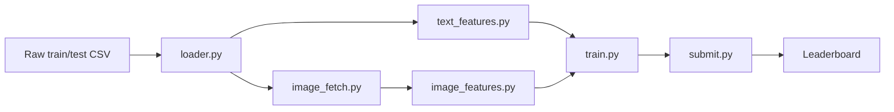

# Architecture Prototype

> Additions from [decision-review.md](decision-review.md): shared `folds.csv`, a kNN feature step, and `preds/{model}_{oof,test}.parquet` feeding a blend step.

## Pipeline modules

- `data/loader.py` — reads train/test CSVs, fixed-seed CV split, indexed by sample_id
- `data/image_fetch.py` — downloads and caches product images, retries and skips failures gracefully
- `features/text_features.py` — regex-based structured extraction + text embeddings, output keyed by sample_id
- `features/image_features.py` — CLIP embeddings + OCR text, same key convention
- `models/train.py` — LightGBM/CatBoost with CV, metric-agnostic
- `submit.py` — formats output to match the sample submission exactly, validates row count before submitting

## Data flow

Text and image features run in parallel, feeding a shared training step and one submission format.

## Built now vs. waits for the dataset

- Ready before the drop: `loader.py`, `submit.py` skeleton, CV-split logic
- Waits for the dataset: exact schema for `text_features.py` and `image_features.py`, choice of target transform, which modality gets priority
