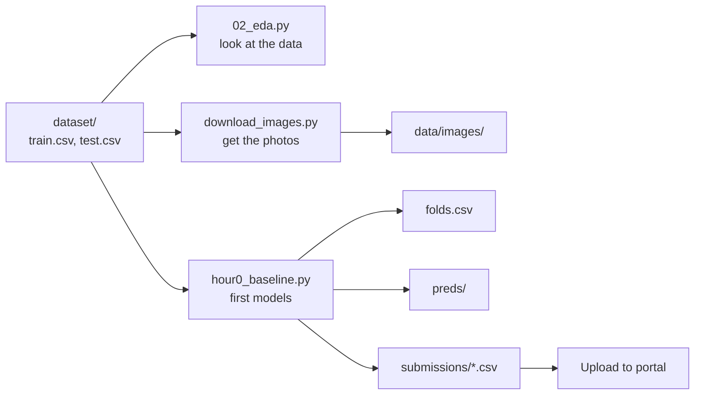

# Toolkit — what's ready and how to use it

**In one line:** everything needed for the first hour is built and tested on the 2025 data. You can go from "dataset downloaded" to "a valid first submission" with 3 commands.

## The picture: how the pieces connect

Think of it as a kitchen. Some pieces are **tools** (knives, pans) that never change. Some are **recipes** that use the tools. Some are **what comes out** (dishes).



## 1. Tools — `src/amlc/` (reusable building blocks)

You rarely run these directly; scripts import them. Every one has tests in `tests/`.

| File | What it does, in plain words | How you'd use it in your own code |
| --- | --- | --- |
| `metrics.py` | The judge's scoring rule (SMAPE), so we can mark ourselves before uploading | `from amlc.metrics import smape` → `smape(real_prices, my_guesses)` → a number, lower is better |
| `data.py` | `load()` reads train/test. `make_folds()` splits train into 5 groups so we can "hide" one group at a time and test ourselves honestly | `train, test = load("dataset")` · `folds = make_folds(train, 5, "stratified", target="price")` |
| `submit.py` | The **bouncer**: refuses a submission with wrong columns, a missing or extra row, duplicate IDs, or empty, zero or negative prices. Then writes the CSV | `write_submission(df, test.sample_id, "submissions/x.csv", ["sample_id", "price"])`. If it raises an error, **don't upload** |
| `images.py` | Downloads photos many at a time, shrinks them to 512 px, retries failures, and skips ones already done (so it can resume) | Used by `scripts/download_images.py`; you rarely call it directly |

> **Tech words:** a folder of reusable code like `src/amlc/` is a **package**; each file is a **module**.

## 2. Recipes — `scripts/` (things you run on hackathon day)

### `scripts/download_images.py` — get all photos

```
nohup uv run python scripts/download_images.py --data dataset --workers 48 > download.log 2>&1 &
```

- **What happens:** every train and test photo is saved as `data/images/<sample_id>.jpg`, plus a report `data/images_manifest.csv` (ok / skipped / failed per photo).
- **Why `nohup … &`:** it runs in the background and keeps going even if you close the terminal. Check on it with `tail download.log`.
- **If it crashes or some photos fail:** run the **same command again**. Finished photos are skipped; only the missing ones are retried.
- **Speed test first (optional):** add `--limit 300 --out data/images_test` to try 300 photos.
- **2025 numbers:** about 12 photos/s, about 50 KB each, so about 3.5 h and 7.5 GB for 150k photos.

### `scripts/hour0_baseline.py` — first two submissions

```
uv run python scripts/hour0_baseline.py --data dataset --mode stratified
```

It does four things, in order:

1. **Makes `folds.csv`**: every training row gets a group number 0–4. **Every model the team builds must use this same file**, so scores are comparable and the models can be mixed later.
2. **Median model:** guesses the middle price for everything. Proves the whole pipeline works. 2025: **72.7**.
3. **TF-IDF + Ridge model:** turns the text into word and letter-piece counts, then learns a price from them (on the log ladder). 2025: **52.0**, in about 5.5 min, using 2.1 GB of RAM.
4. **Saves everything:**
    - `preds/<model>_oof.parquet`: the model's guesses for each training row, made while that row was hidden (honest self-test guesses)
    - `preds/<model>_test.parquet`: the model's guesses for the test set
    - `submissions/<model>.csv`: a ready-to-upload file, already checked by the bouncer

Options: `--mode random|stratified|group` (how to split, from the day-1 checks), `--text` / `--target` if the new dataset uses different column names.

> **Tech words:** **OOF** = out-of-fold predictions. **Parquet** = a fast, compact file format for tables. **TF-IDF** = counts words, giving more weight to rare, informative words and less to common ones like "the". **Ridge** = a simple linear model that avoids over-trusting any single word.

## 3. Checks — `experiments/` (look before you leap)

| File | What it tells you | Run |
| --- | --- | --- |
| `02_eda.py` | Price spread, the median-guess score, what's inside the text, **whether train and test look alike** (which decides `--mode`) | `uv run python experiments/02_eda.py dataset` |
| `01_smape_demo.py` | Lesson 1's experiment: which kind of guess SMAPE likes | `uv run python experiments/01_smape_demo.py` |

`02_eda.py` assumes 2025-style text (`Item Name:`, `Value:`, `Unit:`). If this year's schema is different, parts of it will need adjusting.

## 4. Safety net — `tests/`

```
uv run pytest
```

23 small checks. Run them after changing anything in `src/amlc/`. All green = you didn't break a tool.

## 5. Where things end up (not in git)

| Folder / file | What's in it | Why it isn't in git |
| --- | --- | --- |
| `dataset/` | The hackathon CSVs | Big, and given to us |
| `data/images/` | Downloaded photos | Gigabytes |
| `folds.csv` | Fold number per training row | Regenerated by the script (but **share the same file with teammates** once it's made) |
| `preds/` | Every model's OOF + test guesses | Big; share through a drive if needed |
| `submissions/` | Upload-ready CSVs | Generated |

## 6. What's NOT built yet

| Missing piece | When we need it |
| --- | --- |
| Unit parser / normaliser (`Value`, `Unit`, 64 spellings) | Hours 3–15 |
| Embeddings (text + image → numbers) | Hours 3–15; **needs a GPU (Kaggle/Colab)** |
| LightGBM + "similar product" (kNN) price features | Hours 3–15 |
| Fine-tuned text model | Hours 15–40, **GPU** |
| Blend + scale nudge + clipping | Hours 55–65 |
| Metrics other than SMAPE | Only if this year's metric differs; write it with tests at minute 30 |

## 7. The whole first hour in 3 commands

```
nohup uv run python scripts/download_images.py --data dataset --workers 48 > download.log 2>&1 &
uv run python experiments/02_eda.py dataset
uv run python scripts/hour0_baseline.py --data dataset --mode stratified
```

Then upload `submissions/tfidf_ridge.csv` and log it in [`hour0-runbook.md`](hour0-runbook.md#submission-log).

**Before running on a fresh machine:** install uv, then `uv sync` in the repo. That installs Python 3.12 and every library we use.
