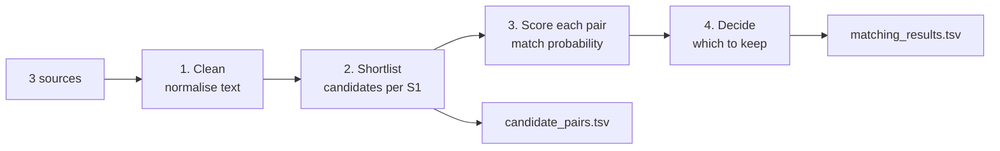

# Plan — 2026 Business Entity Resolution

_2026-09-25. Built from [analysis.md](analysis.md). Items marked **TEAM DECIDES** are open on purpose._

## 1. The shape of the problem, in plain words

We have a clean phone book (Source 1) and two messy phone books (Source 2, Source 3). For every entry in the clean book, we must list every messy entry that is the same business. There are about 10 million messy entries, so we **can't compare every pair** (1.7M × 10M = 17 trillion comparisons).

So, like every entity-resolution system, the work splits into stages:

| Stage | Plain words | What limits it |
| --- | --- | --- |
| 1. Clean | Make "L.L.C." = "LLC", "St" = "Street", strip junk like `***`, handle accents and scripts | Rules must also work for France, which isn't in train |
| 2. Shortlist ("blocking") | For each S1, quickly find a small set of S2/S3 records that *might* match (same country, similar name or address) | **A match missing from the shortlist can never be found.** This sets our recall ceiling |
| 3. Score ("matching") | For each shortlisted pair, compute similarity features and have a model say how likely it's a match | 40% of S1 names are shared by other businesses, so address matters |
| 4. Decide | Keep pairs above a threshold; an S1 with nothing confident gets an empty list | F0.5 punishes wrong merges twice as much as misses; an empty list is worth 1.0 for singletons |

> **Tech words:** stage 2 is **blocking** or **candidate generation**. Its quality is measured by **pair recall** (what share of true matches survive into the shortlist) and **reduction ratio** (how much smaller the shortlist is than all pairs). Stage 3 is a **pairwise classifier**.

## 2. How we test ourselves (before any model)

- **Scorer:** our own implementation of macro F0.5 per S1, written from the README formula, with tests using the README's own example (0.714).
- **Holdout:** set aside a slice of **train S1 businesses together with their matches**. Everything else in train is for learning.
- **Two numbers for every experiment:**
    1. **Shortlist recall** on the holdout: the ceiling
    2. **F0.5** on the holdout: the real score
- **Scale:** develop on a smaller slice (e.g. one country or a fraction of S1) so experiments take minutes. Run the full data only for submissions.
- **TEAM DECIDES:** how to build the holdout so it mimics test, especially the ~26% distractor records and the different country mix.

## 3. Timeline (72 h, from 2026-09-25 12:00)

| Hours | Goal | Done when |
| --- | --- | --- |
| **0–4** | Analysis (done) · F0.5 scorer with tests · holdout · a **simple rule baseline** end to end through the official validator | Upload #1 is valid and scored |
| 4–16 | Shortlist v1 with recall measured · pair features + classifier v1 · threshold tuned for F0.5 | Upload #2 beats the rule baseline |
| 16–52 | **Improvement loop**: the team reviews wrong merges and missed matches on the holdout, decides what to change, tests on the holdout | Each change is kept only if holdout F0.5 improves |
| 52–64 | Freeze. Full test run (time it: it's the largest job). Final threshold | Final `matching_results.tsv` + `candidate_pairs.tsv` validated |
| 64–72 | Final zip: `code/` runs end to end from its README, pinned `requirements.txt`, filled `Documentation_template.md` | Zip checked by rebuilding from a clean checkout |

**Uploads:** 5 per day, about 15 in total. Upload only when the holdout improves meaningfully. Keep 2 for the last day. Log every upload with its holdout score.

## 4. Roles (suggested, based on the original split; **TEAM DECIDES**)

| Person | Owns |
| --- | --- |
| Vaibhav | Pipeline and infra: data loading at scale, scorer, holdout, shortlist recall measurement, output + validator, final zip. Final calls |
| Teammate 2 | Pair features, classifier, threshold |
| Krithi | Reviewing mistakes on the holdout (wrong merges, missed matches), noting patterns, the documentation template |

## 5. Constraints that shape the build

- **Memory:** about 24M records against 5.7 GB of laptop RAM. Read only the needed columns, process one source or one country at a time, use compact dtypes, and print peak memory.
- **Compute:** **TEAM DECIDES** whether full runs happen on Kaggle or Colab (about 30 GB RAM) or on the laptop with chunking.
- **Reproducibility:** the final zip must regenerate both outputs from the data. Keep every step a script, not notebook-only.
- **Rules:** no external lookups (geocoding, registries, APIs). Models at most 8B parameters, MIT or Apache licence.

## 6. Open questions for the team

- [ ] **France** is 15% of test with no training examples. How do we make sure our cleaning, shortlist and model work for it?
- [ ] **Precision versus recall:** how cautious should the decision step be? It's measured on the holdout, but the policy is ours.
- [ ] **Holdout design** (section 2).
- [ ] **Compute platform** (section 5).
- [ ] Which reusable pieces from the 2025 prep to restore (tag `prep-2025-price`): the top-k similarity search, the low-memory character TF-IDF, LightGBM.
